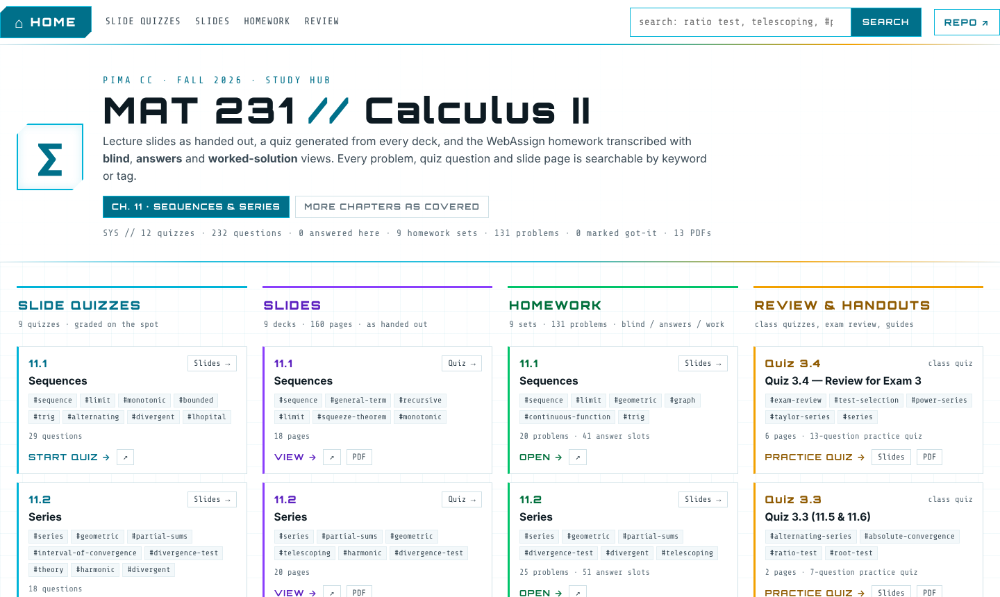

# MAT 231 Study Hub — Calculus II

<p align="center">
  <a href="https://n-herling-mk1.github.io/MAT_231_Calc_II/" target="_blank" rel="noopener">
    
  </a>
</p>

<p align="center">
  <a href="https://n-herling-mk1.github.io/MAT_231_Calc_II/" target="_blank" rel="noopener"><b>▶ Open the live site ↗</b></a>
  &nbsp;·&nbsp; https://n-herling-mk1.github.io/MAT_231_Calc_II/
</p>

Static study site for MAT 231 (Calculus II, Pima CC, Fall 2026). It is organized by chapter: the home page lists the chapters, and each chapter has its own hub with the lecture slides as handed out, a quiz built from every deck, problem sets with worked solutions, the WebAssign homework with **blind / answers / work** views, and a search page that finds problems, quiz questions and slide pages by keyword or tag. It is plain HTML, CSS and JavaScript with no build step, and it works opened straight from disk (`file://`) or served by GitHub Pages. The theme is TRON light: a white field, Orbitron and Share Tech Mono type, and cyan, violet, green and amber accents.

Chapter 11 (Sequences & Series) is loaded: 9 slide decks, 1 problem set, 2 handouts, 2 class quizzes, 9 homework sets (131 problems), and 12 quizzes (232 questions).

## Layout

Two levels: the **course home** (`index.html`) shows one card per chapter, and each **chapter folder** (`ch11/`, later `ch7/`, …) holds that chapter's hub page, PDFs, homework and quizzes. The slide viewer, the search page and all assets are shared at the root.

```
index.html                  course home: one card per chapter (counts, progress, top tags) → chapter hub
search.html                 keyword + tag search over every chapter; filters for chapter, section and type
viewer.html                 viewer.html?d=11-8&v=ans#page=4 — PDF viewer for every chapter: deck picker grouped by
                            chapter, Blank/Answers toggle, Problems/Solutions toggle for problem sets, page deep links
ch11/                       Chapter 11 — Sequences & Series
  index.html                chapter hub: four columns (slide quizzes | slides | homework | review, problem sets & handouts)
  slides/                   the instructor's PDFs, as is (11.8 and 11.9 also have *_answers.pdf), plus problem sets
  slides/src/               LaTeX sources of the problem sets
  hw/hw-11-N/               index.html (same page for every set) + data.js + img/ (original WebAssign screenshots)
  quizzes/quiz-11-N/        one quiz per deck: index.html + data.js
  quizzes/quiz-tests-guide/ quiz from the "Which Convergence Test Should I Use?" handout
  quizzes/review-quiz-3-3/  practice version of class Quiz 3.3
  quizzes/review-quiz-3-4/  practice version of Review Quiz 3.4 (Exam 3 review)
assets/
  css/site.css              course home, chapter hubs, search and homework pages (TRON light)
  css/quiz.css              quiz pages and the viewer (D2L-style base from the CHEM 181 hub + TRON light override at the end)
  js/chapters.js            CHAPTERS: the chapter list (number, folder, title, sections, exam) — the top layer
  js/hub.js                 draws a chapter hub (ch<N>/index.html picks its chapter with <body data-ch="N">)
  js/slides.js              SLIDE_DECKS: every PDF (chapter, kind deck/handout/review/problems, pages, answers version, quiz/hw links, tags)
  js/manifest.js            GENERATED by tools/build_manifest.js: homework sets + quizzes per chapter, with counts and top tags
  js/slide-text.js          GENERATED by tools/extract_slide_text.py: page text of every PDF, for search
  js/hw-engine.js           homework renderer (blind / answers / work, screenshots, self-marks)
  js/quiz-engine.js         quiz renderer + grader (from the CHEM 181 hub; adds tags, slide-page links, typed expressions)
  vendor/katex/             KaTeX 0.16 + auto-render (MIT), bundled for offline use
  vendor/fonts/             Orbitron + Share Tech Mono (SIL OFL)
tools/                      page templates (chapter hub, homework, quiz), authoring helpers, and the two generators
```

**Paths.** Inside a chapter, paths in the data are relative to the chapter folder: `quiz: "quizzes/quiz-11-2/index.html"` in `slides.js` and in a homework `data.js`, `hw: "hw/hw-11-2/index.html"` in a quiz `data.js`, and `href` / `data` in the manifest (each manifest entry also carries `ch` and `dir`). PDFs are found at `<dir>/slides/<file>.pdf`. Deck keys (`11-2`, `ps-11-2`, `quiz-3-4`) are unique across all chapters, since the shared viewer looks them up by key.

## Problem sets

A problem set is a PDF built from a deck: every problem from the slides with repeats removed, problems first and worked solutions after. It is listed in `slides.js` with `kind: "problems"`, `deck` (the source deck's key) and `solPage` (first page of the solutions). The chapter hub shows it in the review column with **Problems** and **Solutions** buttons, the source deck's card gets a **Problems** link, and the viewer adds a Problems / Solutions switch. The LaTeX source sits in `<dir>/slides/src/`.

## Homework pages

- **Blind** shows only the problem; each answer slot is a blank you can click to reveal that one part. **Answers** shows the final answers. **Work** adds the worked solution. The page-wide mode is in the top bar, and every problem has its own mode buttons that override it.
- **Screenshot** opens the original WebAssign capture. These captures include the graded submission, so they stay hidden until asked for.
- Multiple-choice parts list all the options; the keyed option lights up when the part is shown.
- **✓ Got it / ↻ Review** marks each problem; the side map colors them, and **Show Review only** filters the page down to the flagged ones. Marks are saved per set in `localStorage`.
- `#p12` at the end of the URL jumps to problem 12 (the search page uses this).

## Quizzes

- Every question links to its source slide page (`p. 7 ↗`) and carries tags that link to the search page.
- Question types are `single`, `multi` (scored right-minus-wrong per option) and `numeric`. Typed answers accept fractions and expressions: `5/7`, `ln(3)`, `pi/4`, `e^-2`, `sqrt(2)/2`, `1/(3e)`.
- **Check**, **Grade all**, **Peek** and the explanation panel work as on the CHEM 181 hub. `#q12` jumps to question 12.

## Search and tags

`search.html?q=telescoping`, `search.html?tag=ratio-test&type=hw`, `search.html?q=%23p-series%20integral`. All keywords must match (title, text or tags). `#tag` in the box filters by tag, and `"quoted phrases"` stay together. Clicking tags in the cloud combines them. Filters cover chapter, section and type (homework / quiz / PDF / slide page); `ch=11` in the URL limits the search to one chapter, and the search box on a chapter hub searches that chapter.

Tags are added by hand: `tags: [...]` on every homework problem and quiz question, and on every PDF in `slides.js`. Use the existing vocabulary (lower-case, hyphenated: `ratio-test`, `interval-of-convergence`, `alternating-series-estimate`, …) so the tag cloud stays clean.

## Adding a chapter

1. **Register it:** add `{ ch: 12, dir: "ch12", title: "…", sections: "…", exam: "…", blurb: "…" }` to `CHAPTERS` in `assets/js/chapters.js`.
2. **Hub page:** make `ch12/` and copy `tools/chapter_page_template.html` to `ch12/index.html`, changing `data-ch="11"` to `data-ch="12"`.
3. **Slides:** copy the PDFs into `ch12/slides/`, add entries with `ch: 12` to `SLIDE_DECKS` in `assets/js/slides.js`, then run `python3 tools/extract_slide_text.py` (needs poppler's `pdftotext`).
4. **Homework:** make `ch12/hw/hw-12-N/`, copy `tools/hw_page_template.html` to `index.html`, put the screenshots in `img/`, and write `data.js` (schema at the top of `assets/js/hw-engine.js`; `ch11/hw/hw-11-4/data.js` shows multiple-choice parts).
5. **Quizzes:** make `ch12/quizzes/quiz-12-N/`, copy `tools/quiz_page_template.html` to `index.html`, and write `data.js` starting with the helper block in `tools/quiz_helpers.txt` (`mc`, `multi`, `num`).
6. Run `node tools/build_manifest.js` to refresh the cards and the search index list.

The course home, the chapter tabs, the viewer's deck picker and the search filters all pick up the new chapter from `chapters.js`.

## Hosting on GitHub Pages

Settings → Pages → Deploy from branch → `main` / root. The `.nojekyll` file makes Pages serve the files as they are.
